# PDF Password Cracking – Networkwalks Cybersecurity Program

## Overview
This project covers three password-protected PDF cracking challenges from the Networkwalks Cybersecurity training program. For each PDF, the encrypted hash was extracted and cracked using two separate methods, then confirmed by unlocking the PDF and capturing the flag.

## Objective
- Extract a crackable hash from a password-protected PDF.
- Crack the password using two different methods for comparison.
- Confirm the recovered password by unlocking the PDF and capturing the flag.

## Tools Used
- **Online Hash Crack – PDF Hash Extractor** (onlinehashcrack.com) – used to extract the PDF hash for Method 1.
- **Johnny** (GUI for John the Ripper) – used to crack the extracted hash in Method 1.
- **Networkwalks Hash Calculator** (networkwalks.com/hash-calculator) – used to extract the PDF hash for Method 2.
- **Networkwalks Password Cracker** (networkwalks.com/password-cracker) – used to crack the extracted hash in Method 2.
- **GNOME Document Viewer** – used to open the unlocked PDFs and confirm the captured flag.

## Methodology
For each PDF, two independent methods were used to extract and crack the password:

**Method 1 (Johnny / Online Hash Crack):**
1. Upload the locked PDF to Online Hash Crack's PDF Hash Extractor to extract the hash.
2. Load the hash into Johnny and run an attack to recover the password.

**Method 2 (Networkwalks tools):**
1. Upload the same PDF to the Networkwalks Hash Calculator to extract the hash.
2. Run the hash through the Networkwalks password cracker using the built-in list or a custom wordlist.

Both methods were compared to confirm they recovered the same password, then the PDF was unlocked to capture the flag.

---

## Cracking 1 – My Locked PDF1.pdf

### Method 1: Johnny (Online Hash Crack)
Hash extracted:

    $pdf$4*4*128*-1028*1*16*ca7f72f11459cba469f1005a8765ed51*32*f32d8fa1bfbe2648226dffc39f7909ea0021446990b9e4114071a4d9104984c1*32*9322f50c29569712067a775264635e4954ccb1b99e209d664984054ffad30a6a

**Cracked with:** Johnny, built-in wordlist.
**Password recovered:** `good-luck`

Hash extracted via Online Hash Crack:
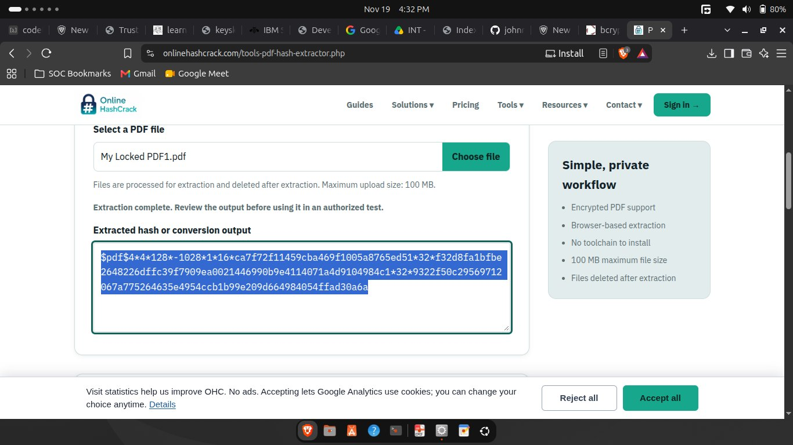

Password cracked in Johnny:
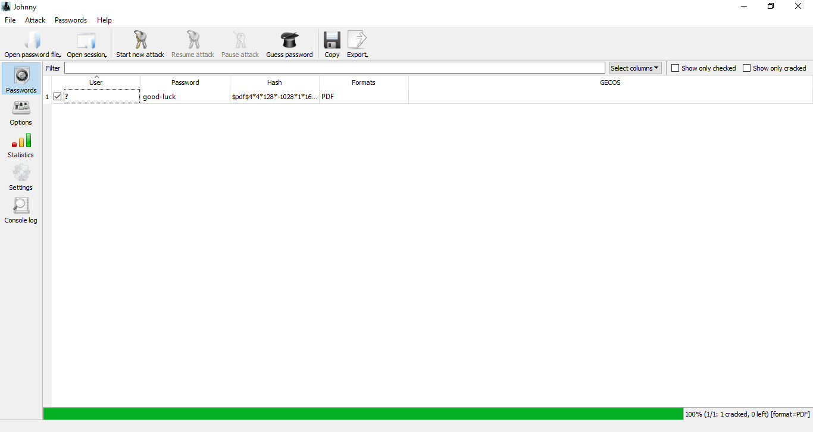

### Method 2: Networkwalks tools
Hash extracted:

    $pdf$4*4*128*-1028*1*16*ca7f72f11459cba469f1005a8765ed51*32*f32d8fa1bfbe2648226dffc39f7909ea0021446990b9e4114071a4d9104984c1*32*9322f50c29569712067a775264635e4954ccb1b99e209d664984054ffad30a6a

**Cracked with:** Networkwalks password cracker, built-in list.
**Password recovered:** `good-luck`

Hash extracted via Networkwalks Hash Calculator:
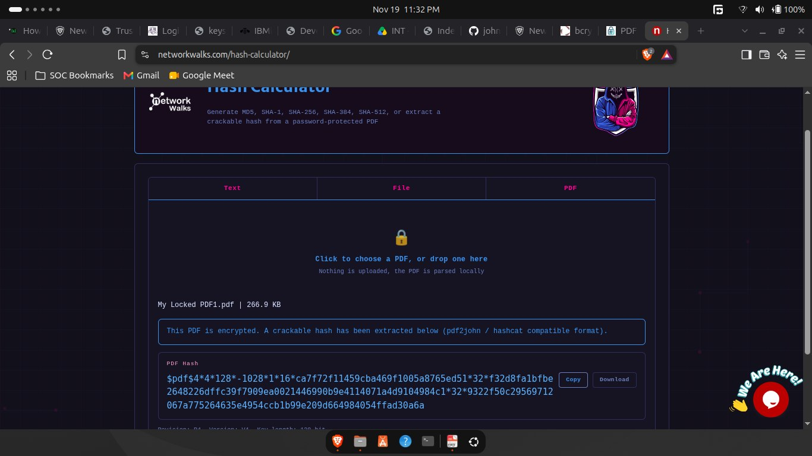

Password match found via Networkwalks password cracker:
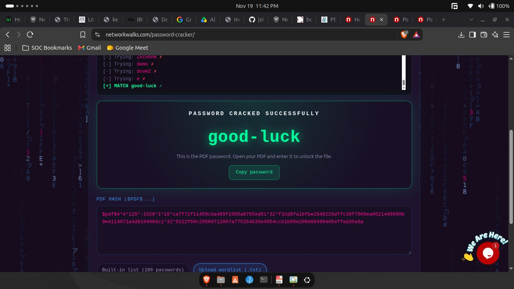

### Result
Both methods recovered the same password: `good-luck`
**Flag captured:** `nw{cybersecurity_flag_captured_2608}`

Unlocked PDF showing captured flag:
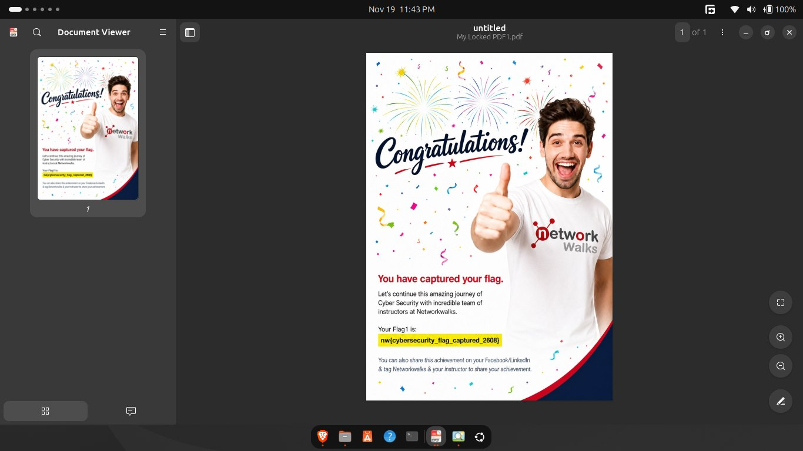

---

## Cracking 2 – My Locked PDF2.pdf

### Method 1: Johnny (Online Hash Crack)
Hash extracted:

    $pdf$4*4*128*-1028*1*16*0853f2cde0ef15b1c0f93ed229d3b1ad*32*8f13ce5aa39ad974364d36a057da76790021446990b9e4114071a4d9104984c1*32*ceecdac74b19b5a62688d3b3524e1374c955cbb9cc3c45316494d9446ef81af1

**Cracked with:** Johnny, built-in wordlist.
**Password recovered:** `password1`

Hash extracted via Online Hash Crack:

Password cracked in Johnny:

### Method 2: Networkwalks tools
Hash extracted:

    $pdf$4*4*128*-1028*1*16*0853f2cde0ef15b1c0f93ed229d3b1ad*32*8f13ce5aa39ad974364d36a057da76790021446990b9e4114071a4d9104984c1*32*ceecdac74b19b5a62688d3b3524e1374c955cbb9cc3c45316494d9446ef81af1

**Cracked with:** Networkwalks password cracker, custom uploaded wordlist (`fasttrack.txt`, 221 words).
**Password recovered:** `password1`

Hash extracted via Networkwalks Hash Calculator:
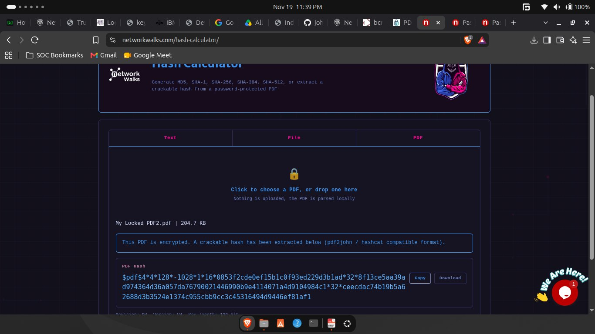

Password cracked via Networkwalks password cracker with custom wordlist:
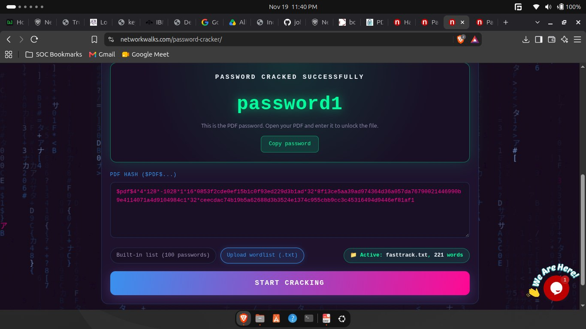

### Result
Both methods recovered the same password: `password1`
**Flag captured:** `nw{networkwalks_persistence_jtr_270521}`

Unlocked PDF showing captured flag:
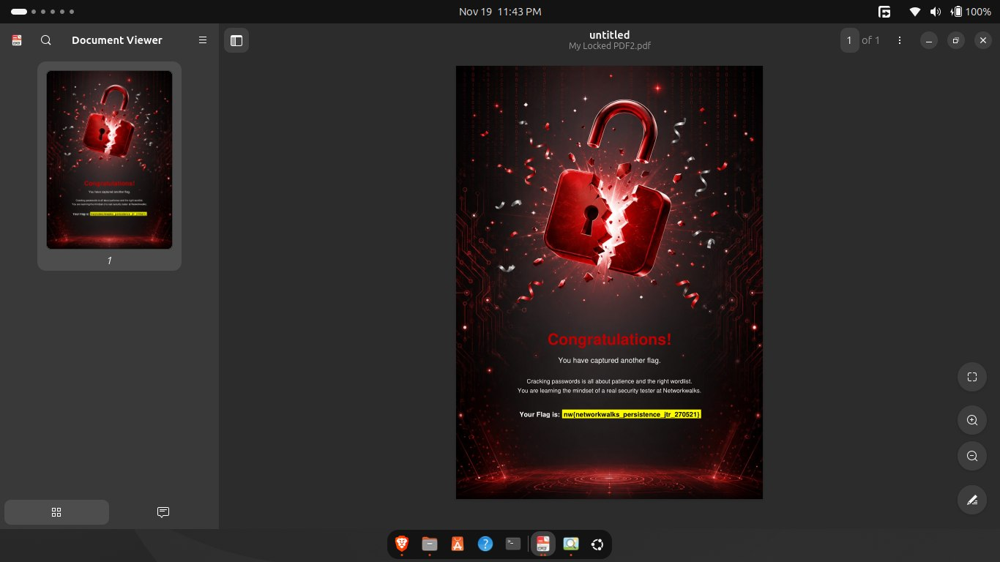

---

## Cracking 3 – My Locked PDF3.pdf

### Method 1: Johnny (Online Hash Crack)
Hash extracted:

    $pdf$4*4*128*-1028*1*16*34eb542eff4e1b0b32d25ce15a9a7281*32*b77872bfc9a24fb2f845066283a8fc1b0021446990b9e4114071a4d9104984c1*32*e7572256e4b552cd57988f5134214b91920d94d7a6bf550ea94a2995c7f2ab02

**Cracked with:** Johnny, built-in wordlist.
**Password recovered:** `1qaz2wsx`

Hash extracted via Online Hash Crack:
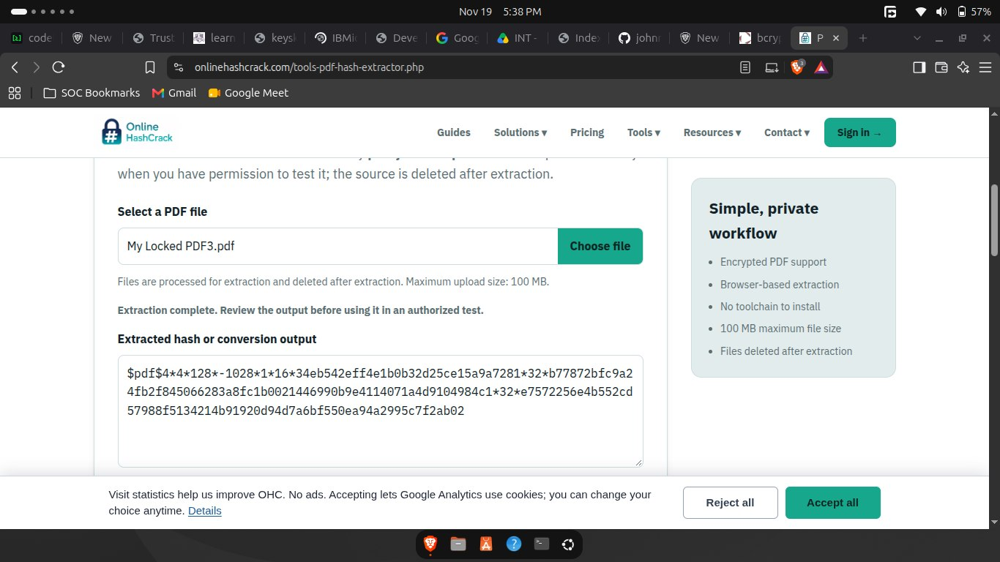

Password cracked in Johnny:

### Method 2: Networkwalks tools
Hash extracted:

    $pdf$4*4*128*-1028*1*16*34eb542eff4e1b0b32d25ce15a9a7281*32*b77872bfc9a24fb2f845066283a8fc1b0021446990b9e4114071a4d9104984c1*32*e7572256e4b552cd57988f5134214b91920d94d7a6bf550ea94a2995c7f2ab02

**Cracked with:** Networkwalks password cracker, built-in list.
**Password recovered:** `1qaz2wsx`

Hash extracted via Networkwalks Hash Calculator:
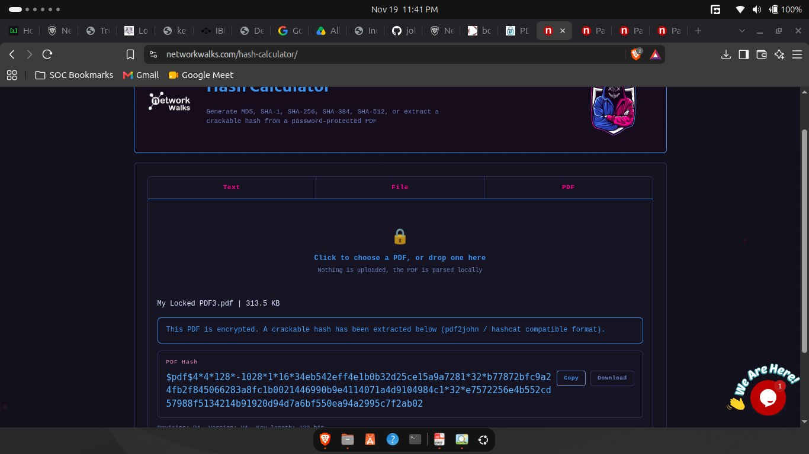

Password match found via Networkwalks password cracker:
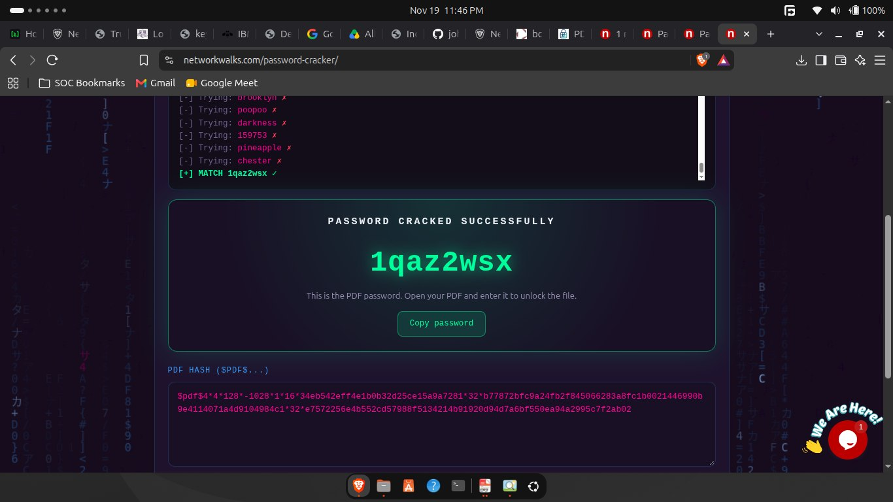

### Result
Both methods recovered the same password: `1qaz2wsx`
**Flag captured:** `nw{networkwalks_flag_260821_1}`

Unlocked PDF showing captured flag:
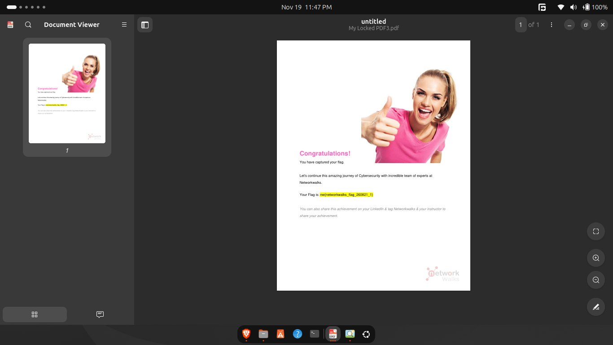

---

## Key Takeaways
- Cross-checking the password with two independent extraction and cracking methods builds confidence that the result is correct, not a tool artifact.
- Common and weak passwords such as `good-luck`, `password1`, and `1qaz2wsx` are cracked almost instantly with small wordlists, showing why predictable passwords are a security risk.
- Custom wordlists, like the `fasttrack.txt` list used for PDF2, can succeed where a small built-in list might fail, which is useful for real-world password audits.

## Author
Ashogbon Ayomikun
LinkedIn: [ayomikun-ashogbon](https://linkedin.com/in/ayomikun-ashogbon-0330a7391)
